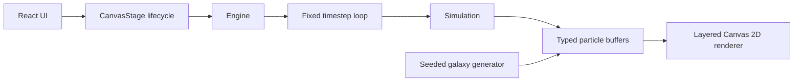

# Particle Universe

An in-progress Canvas 2D cosmic playground, built from [the supplied specification](docs/BUILD_SPEC.md).

**Status: Phase 1 checkpoint, not a finished application.** The first galaxy, ignition animation, deterministic simulation, responsive rendering and live statistics are implemented. The performance gate has not passed; Phases 2–8 have not started.


## Run

Requires Node.js 22+ and npm (or pnpm).

```sh
npm install
npm run dev
```

```sh
npm run typecheck
npm run lint
npm run test
npm run build
npx playwright install chromium
npm run e2e
```

The committed pnpm lockfile supports `pnpm install --frozen-lockfile`. This development environment supplies pnpm rather than npm. Both invoke the same package scripts. The browser test starts the production preview automatically; run the build first.

Press **F** or click **Live observatory** for FPS, frame time and particle count. Other interaction tools belong to subsequent phases and are not implemented yet.

## Architecture



Particle state stays outside React. Rendering uses additive light, cached glow sprites and a static starfield. ResizeObserver manages pixel dimensions; hidden tabs suspend simulation. The frame accumulator caps catchup at four steps.

## Verification and limitations

See [PROGRESS.md](PROGRESS.md) for measured results and outstanding requirements. Hardware-accelerated Edge and Chromium's software-rendered headless shell were tested on this machine. This does **not** establish Chrome/Firefox/Safari release compatibility. The current 20,000-particle renderer falls below the requested 58 FPS gate.

To reproduce using installed Edge on Windows PowerShell:

```powershell
$env:PLAYWRIGHT_CHANNEL = 'msedge'
npm run e2e
node scripts/profile.mjs
```

Profiling writes CPU and sampled allocation evidence into `screenshots/phase-1`. Sampling is diagnostic evidence, not proof of zero allocations.

## Roadmap

Follow [PLAN.md](PLAN.md) in sequence: interaction tools, cosmic entities and fields, validated scenes and presets, text/shapes/photos, saving and sharing, audio, then release polish. The optional AI director is gated on Phase 8 completion. Backend, accounts, cloud saves, public gallery, social features and multiplayer remain out of scope.
