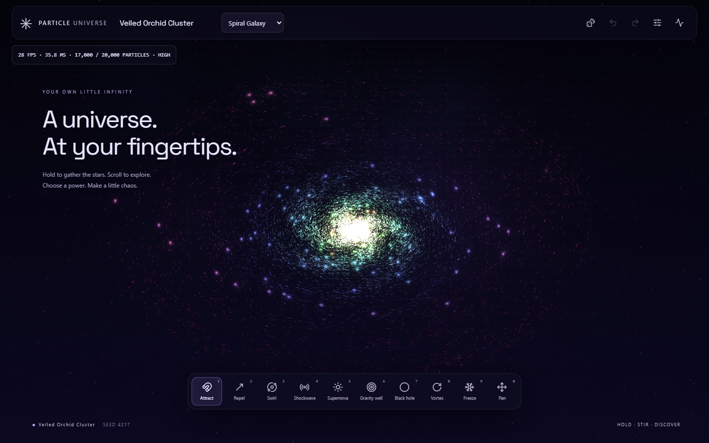
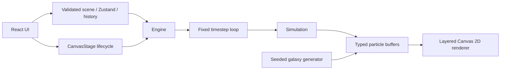

# Particle Universe

An in-progress Canvas 2D cosmic playground, built from [the supplied specification](docs/BUILD_SPEC.md).

**Status: Phase 4 implementation checkpoint, not a finished application.** Includes pointer powers, multi-touch, cosmic objects, curl fields, six presets, validated scenes, live settings, randomization, undo/redo and adaptive quality. Creation, persistence/sharing, audio and release polish remain in Phases 5–8. See the progress log for verification limits.



## Run

Requires Node.js 22+ and npm (or pnpm).

```sh
npm install
npm run dev
```

```sh
npm run typecheck
npm run lint
npm run test
npm run build
npx playwright install chromium
npm run e2e
```

The committed pnpm lockfile supports `pnpm install --frozen-lockfile`. This development environment supplies pnpm rather than npm. Both invoke the same package scripts. The browser test starts the production preview automatically; run the build first.

Press **F** or click **Live observatory** for FPS, frame time, active/configured particle counts and quality. Use **1–0** for tools, **Space** to pause/thaw, **.** to step, **R** to randomize, **Shift+R** for colors, and **Ctrl/Cmd+Z** / **Shift+Ctrl/Cmd+Z** for undo/redo. Scroll to zoom; drag cosmic objects, scroll over them to resize, and right-click or long-press to remove them. Settings sliders apply live; double-click restores the preset value.

## Architecture



Particle state stays outside React. Rendering uses additive light, cached glow sprites and a static starfield. ResizeObserver manages pixel dimensions; hidden tabs suspend simulation. The frame accumulator caps catchup at four steps.

## Verification and limitations

See [PROGRESS.md](PROGRESS.md) for measured results and outstanding requirements. Hardware-accelerated Edge and Chromium's software-rendered headless shell were tested on this machine. This does **not** establish Chrome/Firefox/Safari release compatibility. The current 20,000-particle renderer falls below the requested 58 FPS gate.

To reproduce using installed Edge on Windows PowerShell:

```powershell
$env:PLAYWRIGHT_CHANNEL = 'msedge'
npm run e2e
node scripts/profile.mjs
```

If this host blocks loopback connections, `$env:STATIC_PREVIEW = '1'` enables a Playwright fixture that serves the built `dist` files through browser request interception. It validates the production app in the browser but does not verify Vite's HTTP server. Leave this variable unset for normal preview-server testing.

Profiling writes CPU and sampled allocation evidence into `screenshots/phase-1`. Sampling is diagnostic evidence, not proof of zero allocations.

## Roadmap

Follow [PLAN.md](PLAN.md) in sequence: interaction tools, cosmic entities and fields, validated scenes and presets, text/shapes/photos, saving and sharing, audio, then release polish. The optional AI director is gated on Phase 8 completion. Backend, accounts, cloud saves, public gallery, social features and multiplayer remain out of scope.
